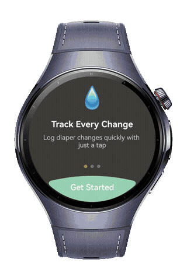
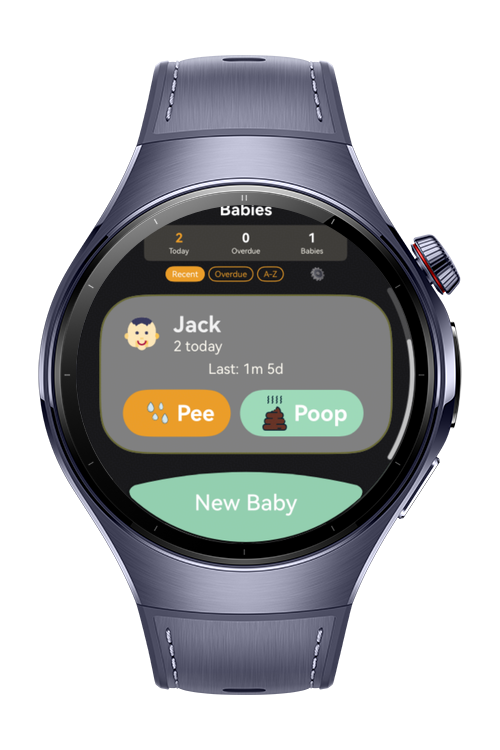
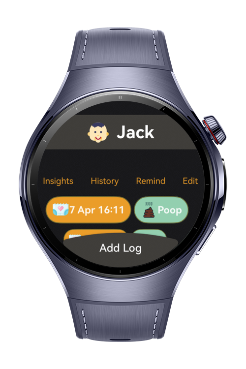
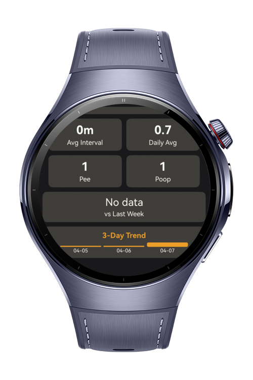

> **Note:** To access all shared projects, get information about environment setup, and view other guides, please visit [Explore-In-HMOS Index](https://github.com/Explore-In-HMOS/hmos-index).

# Baby Day Tracker

**Baby Day Tracker** is a sample HarmonyOS app that makes it easy to record newborn baby's diaper change.

# Preview

<div>
  
  
  
  
</div>

# Use Cases

- **Baby:** Add babies to track their diaper change frequency.
- **Diaper:** Record diaper change.

# Technology

## Stack

- **Languages**: ArkTS, Typescript
- **Frameworks**: HarmonyOS SDK 6.0.0(20)
- **Tools**: DevEco Studio Version 6.0.0(20)
- **Libraries**:
    - `@kit.ArkUI`
    - `@kit.AbilityKit`
    - `@kit.BasicServicesKit`
    - `@kit.ArkData`

# Directory Structure

```
├── entry/src/main/ets/
│   ├──entryability/
│   │  └──EntryAbility.ets              // Main entry point ability
│   ├──entrybackupability/
│   │  └──EntryBackupAbility.ets        // Backup entry ability
│   ├──pages/
│   │  ├──Index.ets                     // App start page / navigation root
├──feature_home/src/main/ets
│   ├──components
│   │   ├──BabyBirthSelect.ets 
│   │   ├──BabyListItem.ets 
│   │   └──GenderSelect.ets 
│   ├──lib
│   │   ├──date-utils.ets 
│   │   └──SizeConstants.ets 
│   ├──models
│   │   ├──Baby.ets 
│   │   └──Diaper.ets 
│   ├──pages
│   │   ├──AddBabyLogPage.ets 
│   │   ├──AddBabyPage.ets 
│   │   ├──BabyPage.ets 
│   │   └──HomePage.ets 
│   ├──viewmodels
│   │   ├──BabyViewModel.ets 
│   │   ├──DiaperViewModel.ets 
│   │   └──ListDataSouce.ets 
│   ├──views
│   │   ├──AddBabyView.ets 
│   │   ├──BabyView.ets 
│   │   ├──DiaperView.ets 
│   │   └──HomeView.ets 
├──feature_splash/src/main/ets
│   ├──components
│   │   ├──Loader.ets 
│   └──SplashPage.ets 
├──feature_store/src/main/ets
│   ├──table
│   │   ├──BabyTable.ets 
│   │   ├──DiaperTable.ets 
│   │   ├──RDBTable.ets 
│   ├──lib
│   │   └──GlobalContext.ets
│   ├──Database.ets
│   ├──Interfaces.ets

```

# Constraints and Restrictions

## Supported Device

- Huawei Watch 5

# LICENSE

**Baby Day Tracker** is distributed under the terms of the MIT License.
See the [license](LICENSE) for more information. 